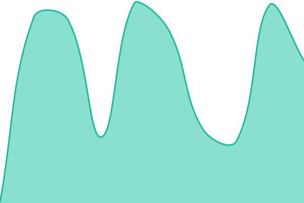

# [📈 Live Status](https://status.readysettlepay.com): <!--live status--> **🟩 All systems operational**

This repository contains the open-source uptime monitor and status page for [Raffi Hovagimian](https://status.readysettlepay.com), powered by [Upptime](https://github.com/upptime/upptime).

With [Upptime](https://upptime.js.org), you can get your own unlimited and free uptime monitor and status page, powered entirely by a GitHub repository. We use [Issues](https://github.com/rhovagimian/rsp-status/issues) as incident reports, [Actions](https://github.com/rhovagimian/rsp-status/actions) as uptime monitors, and [Pages](https://status.readysettlepay.com) for the status page.

<!--start: status pages-->
<!-- This summary is generated by Upptime (https://github.com/upptime/upptime) -->
<!-- Do not edit this manually, your changes will be overwritten -->
<!-- prettier-ignore -->
| URL | Status | History | Response Time | Uptime |
| --- | ------ | ------- | ------------- | ------ |
|  [Web app](https://readysettlepay.com) | 🟩 Up | [web-app.yml](https://github.com/rhovagimian/rsp-status/commits/HEAD/history/web-app.yml) | 

 472ms
     
 | 

<a href="https://status.readysettlepay.com/history/web-app">100.00%</a>
    

|  [Offers and signing](https://readysettlepay.com/health) | 🟩 Up | [offers-and-signing.yml](https://github.com/rhovagimian/rsp-status/commits/HEAD/history/offers-and-signing.yml) | 

 103ms
     
 | 

<a href="https://status.readysettlepay.com/history/offers-and-signing">100.00%</a>
    

|  [Bank linking](https://readysettlepay.com/health) | 🟩 Up | [bank-linking.yml](https://github.com/rhovagimian/rsp-status/commits/HEAD/history/bank-linking.yml) | 

 133ms
     
 | 

<a href="https://status.readysettlepay.com/history/bank-linking">100.00%</a>
    

|  [Disbursements](https://readysettlepay.com/health) | 🟩 Up | [disbursements.yml](https://github.com/rhovagimian/rsp-status/commits/HEAD/history/disbursements.yml) | 

 65ms
     
 | 

<a href="https://status.readysettlepay.com/history/disbursements">100.00%</a>
    

|  [Notifications](https://readysettlepay.com/health) | 🟩 Up | [notifications.yml](https://github.com/rhovagimian/rsp-status/commits/HEAD/history/notifications.yml) | 

 183ms
     
 | 

<a href="https://status.readysettlepay.com/history/notifications">100.00%</a>
    

|  [Staging](https://readysettlepay-465gv7atsq-uc.a.run.app/health) | 🟩 Up | [staging.yml](https://github.com/rhovagimian/rsp-status/commits/HEAD/history/staging.yml) | 

 102ms
     
 | 

<a href="https://status.readysettlepay.com/history/staging">100.00%</a>
    

<!--end: status pages-->

[**Visit our status website →**](https://status.readysettlepay.com)

## 📄 License

- Powered by: [Upptime](https://github.com/upptime/upptime)
- Code: [MIT](./LICENSE) © [Anand Chowdhary](https://anandchowdhary.com)
- Data in the `./history` directory: [Open Database License](https://opendatacommons.org/licenses/odbl/1-0/)
